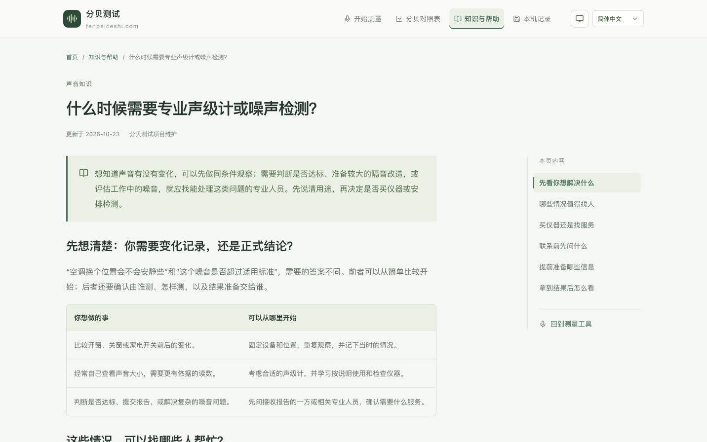
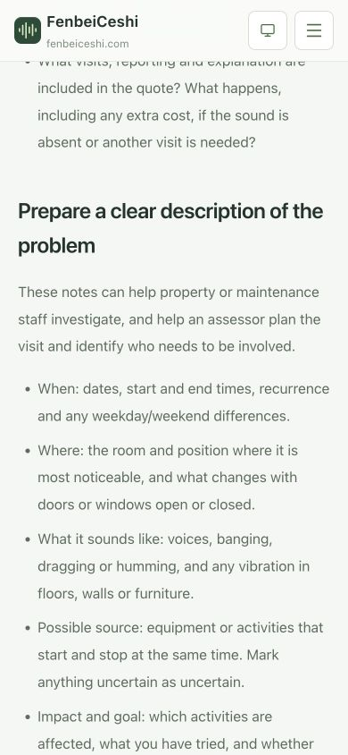

# 专业检测选择三语文章验证

日期：2026-10-23。范围：《什么时候需要专业声级计或噪声检测？》的三语正文、知识目录入口、关联阅读和静态输出。本地实现，尚未部署生产。

## 读者任务与表达

- 用户要求继续补文章，内容不要太偏技术。本篇承接上轮建议的专业仪器／检测选择主题，沿用三语范围。
- 核心任务是决定何时自己观察、何时考虑仪器、何时联系专业人员；先讲生活用途，再讲联系和准备，最后说明怎样理解结果。正文使用邻里、装修、家电和工作场所场景，不展开公式、计权、仪器等级、职业阈值或法律条文编号。
- 六章依次为用途、求助场景、仪器与服务区别、预约问题、联系前清单、结果理解；第一章用两列对照表帮助选择，清单用连续列表呈现。正文复用服务端 ContentPage，不添加卡片、客户端状态或专属样式。
- 修改前已查看实际 Chrome 桌面知识目录。新入口放在“理解读数”组，排在准确性与读数原理之后；保持四个既有分类，不新增容器或分类。
- 主操作回到本篇 `#prepare` 清单，帮助读者整理情况；没有预约服务、品牌排行或用网页出具正式检测结果的承诺。

## 实现与关联

| 语言 | 路径                                                |
| ---- | --------------------------------------------------- |
| 简体 | `/knowledge/when-to-use-a-sound-level-meter/`       |
| 繁体 | `/zh-tw/knowledge/when-to-use-a-sound-level-meter/` |
| 英文 | `/en/knowledge/when-to-use-a-sound-level-meter/`    |

正文位于 `src/lib/content/professional-meter.ts`，复用规划中的 `when-professional-meter` ID 和既有候选路径。`articles.ts` 注册内容，RoutePage 复用 CTA 接口，知识目录保留原分组。准确性、降噪、法规和职业标准四篇新增返回入口；新文章也提供这四篇关联阅读。来源、正文、表格、列表与链接静态输出，metadata、三语语言切换和 sitemap 从同一注册表派生。

新增 3 个 URL 后，全站 141 个 URL，其中 138 个可索引、三个本机记录页 noindex；每种语言 47 个页面。同步关键词映射、SEO 规划、工程数量、AGENTS 和文档索引。首页现有文章列表自动读取注册表，本轮没有修改首页组件或版式，首页内部链接纳入整站产物检查，未单独做首页视觉验收。

## 一手来源与使用边界

以下资料于 2026-10-23 实际读取。清单和预约问题是本站对这些原则的生活化整理，不是统一的法定检测程序，也不提供具体案件或个人职业安全结论。

| 来源                                                                                                     | 本篇使用内容                                                           | 适用范围与边界                                                                                       |
| -------------------------------------------------------------------------------------------------------- | ---------------------------------------------------------------------- | ---------------------------------------------------------------------------------------------------- |
| [CDC/NIOSH: Understand Noise Exposure](https://www.cdc.gov/niosh/noise/prevent/understand.html)          | 按用途选择声级计或个人暴露评估，工作内容和接触时间、仪器检查、专业咨询 | 职业资料仅支持相应工作场所段落与测量方法原则，不将职业值用于住宅，不照搬技术设置                     |
| [CDC/NIOSH: Sound Level Meter App](https://www.cdc.gov/niosh/noise/about/app.html)                       | 验证结果只属于指定应用及设备条件                                       | 未将 NIOSH 的准确度声明移植到本站，没有推荐具体应用或设备                                            |
| [UK HSE: How do I assess the risks?](https://www.hse.gov.uk/noise/risks.htm)                             | 代表性工作情况、评估人员能力、评估包含结果解释与行动                   | 仅整理职业评估原则，不引入英国法规义务或阈值，不强制所有人购买外部检测服务                           |
| [Australian Government · Your Home: Noise control](https://www.yourhome.gov.au/live-adapt/noise-control) | 装修改造前先识别声音路径；涉及明显干扰或较大改造投入时寻求声学咨询     | 采用住宅改善原则，不引入澳大利亚建筑法规或材料效果承诺                                               |
| [生态环境部：生态环境法典](https://www.mee.gov.cn/ywgz/fgbz/fl/202603/t20260313_1146496.shtml)           | 第 599 条社会生活噪声劝阻、调解与投诉安排                              | 三语段落均明确中国大陆范围；其他地区走当地渠道，没有统一主管机关、必须先自费检测或报告必获认可的断言 |

本篇不列检测价格、机构名单或设备推荐。联系前先向报告接收方确认机构条件、项目和形式，是用途核对建议；不保证报告效力，也不把某个资质标识当成所有用途都通用的凭证。

## 验证结果

实际工程命令：

```bash
rtk proxy npm run check > /tmp/noise-professional-meter-check.log 2>&1
rtk proxy git diff --check
```

完整 `npm run check` 退出码为 0：

| 检查               | 结果                                                                                                                                                 |
| ------------------ | ---------------------------------------------------------------------------------------------------------------------------------------------------- |
| `format:check`     | 全部匹配文件通过                                                                                                                                     |
| `lint`             | 通过，零 ESLint 警告                                                                                                                                 |
| `typecheck`        | 通过                                                                                                                                                 |
| `test`             | 144 项通过，0 项失败，新增三语文章面包屑归属覆盖                                                                                                     |
| `test:content`     | 44 组三语正文、138 个可索引 URL、三个 noindex URL，关键词路径与三语字段检查通过                                                                      |
| `build`            | Next.js 静态导出通过                                                                                                                                 |
| `test:export`      | 141 个页面、138 个 sitemap URL、4,947 条内部链接与锚点通过；全文、表格、列表、来源、目录、关联阅读和清单 CTA 保留在 HTML，canonical 与 hreflang 对应 |
| `git diff --check` | 通过                                                                                                                                                 |

npm 有本机既存的 `home` 配置警告，本轮未改动用户 npm 配置。静态检查新增了文章全文、知识目录所属分组和清单 CTA 的覆盖，复用已有检查模块，没有加入内容措辞或实现镜像测试。

Chrome 实际浏览器验收：

- 默认桌面 1432 × 896 与手机 390 × 844，分别打开三语目录和文章，共六个核心 URL、12 个页面／视口组合。每种语言实际从知识目录点击新入口，标题、六节正文、导航高亮和链接语言正确。
- 标题固定 32px、正文固定 16px；长标题和目录正常换行，全部观测无整页横向溢出。对照表桌面宽 748px；手机宽 470px、局部容器宽 348px。
- 英文手机实际点击目录的“What to prepare”，到达 `#prepare`，目录当前项同步，章节顶部位于约 190px 的可见区域。
- 英文手机表格实际向右滚动，`scrollLeft` 达到 122px，第二列内容可读，页面宽保持 390px。
- 英文手机实际点击文章主操作“See what to prepare”，到达同一清单；实际点击准确性文章，并通过其新增关联入口返回本篇。
- 验收后清除临时视口覆盖，恢复桌面简体文章预览。没有请求真实麦克风权限。
- [浏览器观测记录](../../design/professional-meter-v1/browser-validation.json) 保存 18 次页面／交互观测，目录与文章三语桌面／手机截图、英文手机清单与表格截图位于同目录。

代表性截图：






## 职责与未验证范围

应用 React 性能技能，将全文、来源和入口留在服务端，沿用既有目录交互；应用文档维护技能同步路由与发布状态。按 simplify 复核职责、复用和规模：新增正文 285 行有效代码，RoutePage 为 134 行，静态产物主检查为 657 行，均在项目限制内；没有新增依赖、样式或通用框架，不扩展测量、音频、记录或存储实现。

本次不验证真实声学精度、实际仪器或机构服务、真实手机设备、生产部署和 CDN。手机视口验收只覆盖移动 Web 阅读与交互。
