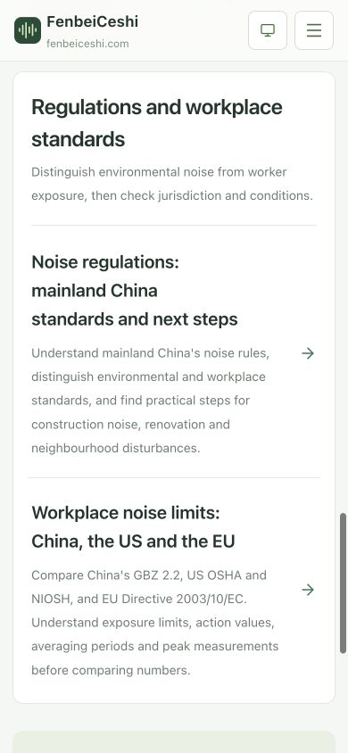
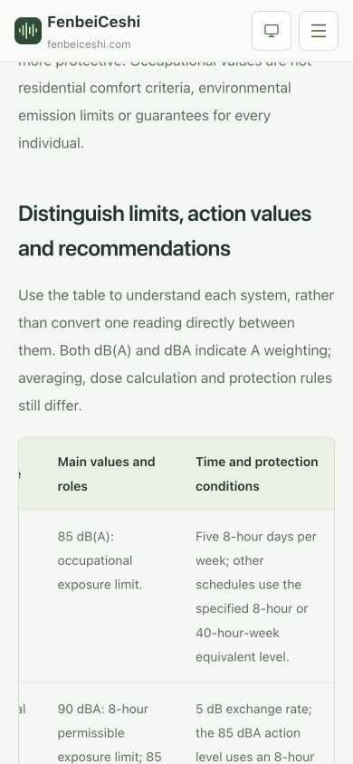

# 噪音法规与职业标准三语文章验证

日期：2026-10-22。范围：两篇文章的简体、繁体和英文六个 URL，三语知识与帮助目录，相关静态发布信息。本地实现，生产尚未部署。

## 任务与阅读层级

修改前已在实际 Chrome 查看知识目录。此前读数、声音参考和健康方法已有分组，法规判断和职业标准缺少独立入口。本次沿用现有连续文章、目录和表格，新增“法规与职业标准”主题组，把两个适用范围不同于健康方法的任务放在同一主题表面；不新增正文卡片、客户端文章状态、依赖或 CSS。

- 法规篇复用原规划 `/knowledge/china-noise-standards/`，回答中国大陆适用什么文本、如何读条件、施工与装修区别及如何描述困扰。三语均明确同一大陆法域，不因繁体或英文而改成台湾或全球法规。
- 对比篇使用 `/knowledge/workplace-noise-standards/`，讨论中国大陆 GBZ 2.2、美国联邦一般工业 OSHA、NIOSH 建议、欧盟最低要求，避免形成只按数字排列的宽严榜。
- 正文分别维护在 `src/lib/content/china-noise-standards.ts` 与 `src/lib/content/workplace-noise-standards.ts`；`articles.ts` 注册内容，知识目录、路由 CTA 和静态检查各沿用原有入口。
- 英文分别位于 `/en/`，繁体分别位于 `/zh-tw/`；显式维护真实正文。正文、表格、来源与关联链接静态输出；文章主操作分别进入职业对比和听力保护。
- 首页现有文章列表读取同一注册表，会按既有规则收录两篇；本轮未修改首页组件或版式。完整产物检查覆盖其内部链接，首页不在本轮单独视觉验收范围。
- 同步路由注册、知识目录、关键词归属、三语 SEO、页面数量和实现文档。新增六个页面后，全站 138 个 URL，其中 135 个可索引、三个本机记录页 noindex；每种语言 46 个页面。

## 原文、状态与适用条件

以下资料于 2026-10-22 查阅。已核验原文和适用条件，未声称法律、职业卫生专家审校或具体案件法律意见。

| 资料                                                                                                                                                                                                                                                                                                            | 核验内容及本次使用范围                                                                                                                                                                                                            |
| --------------------------------------------------------------------------------------------------------------------------------------------------------------------------------------------------------------------------------------------------------------------------------------------------------------- | --------------------------------------------------------------------------------------------------------------------------------------------------------------------------------------------------------------------------------- |
| [生态环境部：生态环境法典全文](https://www.mee.gov.cn/ywgz/fgbz/fl/202603/t20260313_1146496.shtml)                                                                                                                                                                                                              | 第 1242 条：2026-08-15 施行并同时废止原噪声污染防治法；第 547 条定义、第 548 条职责、第 553 条区划、第 563 条职业危害分流、第 572 条施工与夜间、第 594、595、599 条生活声、装修及调解报告。没有把夜间施工条款泛化为所有装修时段。 |
| [生态环境部：法典实施通知](https://www.mee.gov.cn/xxgk2018/xxgk/xxgk03/202604/t20260408_1148465.html)                                                                                                                                                                                                           | 交叉核对法典执行日期和现行执法依据，避免把 2022 年法律当成现行独立法律。                                                                                                                                                          |
| [GB 3096—2008](https://www.mee.gov.cn/ywgz/fgbz/bz/bzwb/wlhj/shjzlbz/200809/t20080917_128815.shtml)、[GB 12348—2008](https://www.mee.gov.cn/ywgz/fgbz/bz/bzwb/wlhj/hjzspfbz/200809/t20080918_128936.shtml)、[GB 22337—2008](https://www.mee.gov.cn/ywgz/fgbz/bz/bzwb/wlhj/hjzspfbz/200809/t20080918_128937.htm) | 核对生态环境部现行分类目录与各标准适用对象；仅作质量／厂界／营业设备设施的分类，不搬用一个室内统一阈值，不把社会生活排放标准解释成一切邻里生活声。                                                                                |
| [GB 12523—2025 页面及原文](https://www.mee.gov.cn/ywgz/fgbz/bz/bzwb/wlhj/hjzspfbz/202512/t20251211_1137517.shtml)、[国家标准状态](https://openstd.samr.gov.cn/bzgk/std/newGbInfo?hcno=DFB5F8F95BB6BCFFE872B3D387C157C7)                                                                                         | 2026-01-01 实施并替代 2011 版。PDF 第 5 页（印刷页 2）表 1：施工场界等效声级昼 70／夜 55 dB(A)，另有夜间最大声级及测点要求；范围排除抢修抢险排放管理，建筑施工定义不含已交付建筑室内装修。已实际渲染并目视核对表格与脚注。        |
| [中国疾控中心职业卫生所现行目录](https://niohp.chinacdc.cn/sndt/202511/t20251128_313733.htm)                                                                                                                                                                                                                    | 页面路径为 2025，但正文目录截止日期为 2026-02-28，仍列 GBZ 2.2—2007；以正文状态而非 URL 年份判断。                                                                                                                                |
| [GBZ 2.2—2007 原文 PDF（上海科技大学 EHS 存本）](https://ehs.shanghaitech.edu.cn/_upload/article/files/88/7f/4d66b7a04d2fb7defcd2917fb368/a6ee5442-447a-4b74-9d40-ec2626a4bf79.pdf)                                                                                                                             | 扫描原文 PDF 第 8 页（印刷页 6）已渲染目视核对：11.2.1／表 9 为 85 dB(A) 与 8／40 小时条件；11.2.2／表 10 的脉冲次数为 ≤100、100<n≤1000、1000<n≤10000，对应 140／130／120，原表单位 dB(A)；11.3 指定 GBZ/T 189.8。                |
| [OSHA 29 CFR 1910.95](https://www.osha.gov/laws-regs/regulations/standardnumber/1910/1910.95)                                                                                                                                                                                                                   | 表 G-16 的 90 dBA／8 小时及 5 dB 交换关系；85 dBA 的 8 小时 TWA 听力保护行动值，未扣除听力防护衰减；冲击声条款原写 140 dB peak SPL，不擅自改写为 dBA/dBC。                                                                        |
| [OSHA 行业标准](https://www.osha.gov/noise/standards)、[州计划](https://www.osha.gov/stateplans)                                                                                                                                                                                                                | 一般工业与建筑等行业分别适用，州计划至少同等有效，可存在不同要求；未称联邦一般工业值适用于美国所有工作。                                                                                                                          |
| [NIOSH: Understand Noise Exposure](https://www.cdc.gov/niosh/noise/prevent/understand.html)                                                                                                                                                                                                                     | 推荐 85 dBA／8 小时、3 dB 交换率；100 dBA 对应 15 分钟仅作稳定声级关系例子，不是个人安全倒计时，不当作 OSHA 法律。                                                                                                                |
| [EU-OSHA 指令页面](https://osha.europa.eu/en/legislation/directives/82)、[西班牙 BOE 所载欧盟官方公报原文](https://www.boe.es/buscar/doc.php?id=DOUE-L-2003-80227)                                                                                                                                              | 2003/10/EC 第 2–6、8 条：LEX,8h、80／85 行动值及 87 dB(A) 限值，限值考虑防护而行动值不扣减；135／137／140 dB(C) 峰值，周暴露采用条件、控制和用品要求。成员国转化及更严格规定须另查。                                              |

访问限制如实记录：NHC 及职业卫生所 GBZ 原文下载链接存在超时或防火墙返回，NHC 索引片段与官方现行目录可读，最终以大学机构保存的标准原文扫描件逐页核对表格，未将搜索片段或未成功下载文件称为完整原文阅读。EUR-Lex 直接全文接口出现机器人校验，改用 EU-OSHA 官方说明及 BOE 转载的欧盟官方公报全文。英国法规站 PDF 一次抓取可见文本但直下载为空，未依赖其本地文件作核验。施工标准使用生态环境部成功下载的原始 PDF。

## 验证记录

工程检查实际命令：

```bash
rtk proxy npm run check > /tmp/noise-standards-check.log 2>&1
rtk proxy npm run test:export
rtk proxy git diff --check
```

| 检查               | 实际结果                                                                                                                            |
| ------------------ | ----------------------------------------------------------------------------------------------------------------------------------- |
| `format:check`     | 全部匹配文件通过                                                                                                                    |
| `lint`             | 通过，零 ESLint 警告                                                                                                                |
| `typecheck`        | 通过                                                                                                                                |
| `test`             | 144 项通过，0 项失败；新增两篇文章的三语面包屑归属覆盖                                                                              |
| `test:content`     | 43 组三语正文、135 个可索引 URL、三个 noindex URL；新增关键词路径和三语段落、列表、表格完整性通过                                   |
| `build`            | Next.js 静态导出通过                                                                                                                |
| `test:export`      | 138 个页面、135 个 sitemap URL、4,839 条内部链接与锚点通过；六页正文、表格、来源、目录、三语 canonical／hreflang 及后续入口静态输出 |
| `git diff --check` | 通过                                                                                                                                |

新增静态检查在首轮发现可选 CTA 的类型收窄不足，以及分组链接选择器误匹配 SVG 的 `href`；已分别补充存在断言并将选择器约束到 `<a>`，随后检查通过。npm 仍有本机既存的 `home` 配置警告，本轮未修改用户配置。

实际 Chrome 验收：

- 1481 × 839 桌面与 390 × 844 手机视口，分别打开三语目录和两篇文章，共九个 URL、18 个页面／视口组合；每种语言均从目录实际点击两篇入口进入，对应语言正文与知识导航高亮正确。
- 两篇文章的六／七个章节、长标题和来源均可阅读，没有整页横向溢出；页面标题固定 32px、正文固定 16px。手机表格沿用局部滚动，表宽 470px、容器 348px，页面宽保持 390px。
- 简体桌面实际点击“施工与装修”，URL 为 `#construction`，对应目录项同步，章节顶部落在可见区域；英文手机点击“Limits and action values”，落到 `#comparison`。
- 英文手机表格实际向右滚动，`scrollLeft` 达到 122px，可阅读第三列条件；没有带动整页横向溢出。
- 英文手机分别点击法规篇“Compare workplace standards”与职业篇“Explore hearing protection”，进入对应英文职业文章与听力保护页。
- 最后恢复 1481 × 839 桌面视口，保留简体知识目录的新分组预览。
- [浏览器观测记录](../../design/noise-standards-v1/browser-validation.json) 保存 24 次页面与交互状态；同目录保存三语目录及六页桌面／手机截图。首批观测器只选择 `aria-current=page`，文章实际使用 `location`，后续已修正观测器并用渲染结果验证高亮，未改动产品导航。

代表性截图：






## 职责与边界复核

- 按 simplify 复核复用和规模：新增正文文件分别为 264、272 行有效代码；`RoutePage` 111 行、静态产物主检查 656 行，均在项目限制内；无需新增抽象或专属样式。
- 正文各一文件，复用 `ContentPage` 的服务端输出；目录继续只承担导航交互，未把整篇文章传给客户端。已应用 React 性能与文档同步技能。
- 保留此前降噪与听力保护功能和用户现有改动，不改变测量、音频、记录、存储、主题或语言偏好。
- 未验证真实设备测量精度、法定现场检测、个人听力防护效果、实际移动设备或生产部署；浏览器手机视口仅验证移动 Web。
