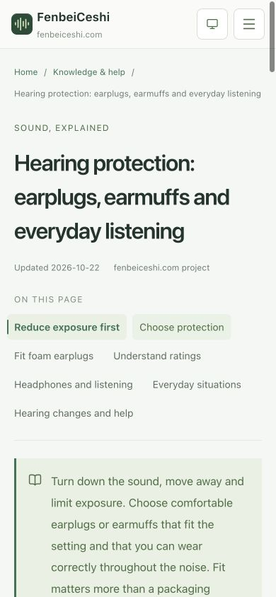

# 降噪与听力保护三语文章验证

日期：2026-10-22。范围：两篇知识文章、简体／繁体／英文六个 URL，以及三语知识与帮助目录的入口。当前仍为本地实现，尚未部署生产。

## 任务与阅读层级

- 降噪方法帮助读者先辨认声源和传播方式，再选择可以尝试的措施，最后用同条件观察检查变化。
- 听力保护帮助读者减少强声暴露、选择并正确使用防护用品，并识别需要专业检查的听力变化；健康影响概览和职业时长关系仍由原健康文章承接。
- 修改前实际查看了知识与帮助目录的桌面渲染。现有健康分类只有健康概览入口，空间改善与防护用品使用缺少独立方法页。
- 新文章复用服务端 `ContentPage` 的连续章节、目录、对照表、来源和关联阅读，不增加客户端正文、独立卡片、浮层或专属样式。目录沿用现有健康分类，在同一主题表面内增加两个同级条目。
- 听力保护的正文主操作进入健康文章的暴露参考，避免把打开麦克风测量误当成听力或防护效果检查。目录侧栏仍可返回通用测量工具。

## 页面与实现

| 内容     | 简体路径                         | 繁体路径                               | 英文路径                            |
| -------- | -------------------------------- | -------------------------------------- | ----------------------------------- |
| 降噪方法 | `/knowledge/noise-reduction/`    | `/zh-tw/knowledge/noise-reduction/`    | `/en/knowledge/noise-reduction/`    |
| 听力保护 | `/knowledge/hearing-protection/` | `/zh-tw/knowledge/hearing-protection/` | `/en/knowledge/hearing-protection/` |

- 正文分别在 `src/lib/content/noise-reduction.ts` 与 `hearing-protection.ts`，每篇七章；简体、繁体与英文显式维护，不在运行时转换正文。
- `articles.ts` 注册两篇内容，现有路由、metadata、语言切换、面包屑、结构化数据和 sitemap 从注册表派生。全站新增 6 个 URL，总计 132 个页面，其中 129 个可索引、3 个记录页 noindex。
- `knowledge-page/index.tsx` 的健康组新增两个入口；`route-page/index.tsx` 复用现有 CTA 参数为听力保护选择健康参考入口。
- 首页现有文章列表直接读取 `articles`，因此会按既有规则自动收录两篇文章；本轮没有修改首页组件或版式。构建 HTML 与链接由整站静态产物检查覆盖，首页未单独进行本轮视觉验收。
- 同步关键词映射、整站规划、工程页数、AGENTS 与文档索引。法规与职业标准对比继续保持原有规划状态。
- 未新增依赖或修改测量、录音、记录、主题、语言偏好存储等实现。

## 一手资料与适用范围

以下资料于 2026-10-22 读取并核对正文。引用机构名及原始标题保持原文，翻译不改写其适用法域。本文为一般科普与方法整理，不声称经过医学专家审校。

| 资料                                                                                                                                         | 本次使用的内容                                                               | 适用边界                                                                            |
| -------------------------------------------------------------------------------------------------------------------------------------------- | ---------------------------------------------------------------------------- | ----------------------------------------------------------------------------------- |
| [Australian Government · Your Home: Noise control](https://www.yourhome.gov.au/live-adapt/noise-control)                                     | 空气声、结构传声、室内反射，完整门窗／墙地系统、通风、声源一侧地毯及专业评估 | 采用住宅声学原理，不引入澳大利亚法规或设计限值，不承诺固定材料降噪值                |
| [CDC/NIOSH · Implement Engineering Controls](https://www.cdc.gov/niosh/noise/prevent/engineering.html)                                       | 维护、声源控制、隔振、反射与屏障；错误支座可能加重振动                       | 原文面向职业工程控制；生活场景仅整理通用原理，安装须匹配设备                        |
| [UK HSE · Workplace design](https://www.hse.gov.uk/noise/goodpractice/workplacedesign.htm)                                                   | 吸音影响反射声、屏障与直达声、噪声区与安静区分隔                             | 不将英国职业要求解释为本地住宅标准                                                  |
| [EPA Victoria · Reduce noise from your home](https://www.epa.vic.gov.au/reduce-noise-your-home)                                              | 音量和低音、维修与维护、活动时段和邻里沟通                                   | 采用行为与维护建议，不引入当地禁用时段或执法结论                                    |
| [NIH/NIDCD · Noise-Induced Hearing Loss](https://www.nidcd.nih.gov/health/noise-induced-hearing-loss)                                        | 单次强声及累计暴露、耳鸣和听觉变化、感觉恢复仍可能有损伤                     | 不依据网页读数诊断个人听力或计算患病概率                                            |
| [CDC/NIOSH · Provide Hearing Protection](https://www.cdc.gov/niosh/noise/prevent/ppe.html)                                                   | 耳塞／耳罩选择、贴合、兼容性、音乐耳塞、消费 ANC 与听力防护的区别            | 不把 NRR 当作每个人实际获得的衰减，也不把消费 ANC 自动视为职业防护                  |
| [CDC/NIOSH · How to Wear Soft Foam Earplugs](https://www.cdc.gov/niosh/mining/tools/earplugs.html)                                           | 清洁双手、搓细／提耳／扶住、捂耳初步检查                                     | 仅针对可回弹软泡棉耳塞；遵循具体产品说明，检查不提供衰减分贝                        |
| [NIOSH Science Policy Update 2025-104](https://www.cdc.gov/niosh/docs/2025-104/pdfs/2025-104.pdf)                                            | 职业计划中的个体定量适合性测试与个人衰减                                     | 不将简易自检称为定量 fit testing，不搬用已被新政策替代的通用 NRR 折算来推断个人保护 |
| [WHO · Safe listening](https://www.who.int/news-room/questions-and-answers/item/deafness-and-hearing-loss-safe-listening)                    | 降低音量、拉开距离、安静休息、贴合耳机与暴露提醒、提高交谈音量的提醒         | 不把音量百分比换算为统一耳内声级，不重复建立娱乐暴露安全倒计时                      |
| [Health Canada · Protect your hearing health](https://www.canada.ca/en/health-canada/services/noise-your-health/protect-hearing-health.html) | 音乐会、体育活动、电动工具与旁人防护                                         | 结合产品警示与场所要求，不作具体产品效果承诺                                        |
| [NIH/NIDCD · Sudden Deafness](https://www.nidcd.nih.gov/health/sudden-deafness)                                                              | 突然听力下降需立即就医，不应自行当作耳垢等待                                 | 只提供寻求帮助的指引，不推断症状病因或提供治疗方案                                  |
| [CCOHS · Hearing Protectors](https://www.ccohs.ca/oshanswers/prevention/ppe/ear_prot.html)                                                   | 用品选择、密封、维护，以及双重防护的衰减不能直接相加                         | 不移植加拿大职业限值或标称折算公式到浏览器读数                                      |

降噪文章中的 A／B／A 重复观察及记录条件是本站用于同设备比较的方法，不是从上述资料推导出的标准测试程序；结果不能当作隔声评级、建筑验收、法规合规或听力安全证明。

## 验证记录

工程检查实际命令：

```bash
rtk proxy npm run check > /tmp/noise-practical-guides-check.log 2>&1
```

最终退出码为 0，逐项结果如下：

| 检查           | 实际结果                                                                                                                    |
| -------------- | --------------------------------------------------------------------------------------------------------------------------- |
| `format:check` | 全部匹配文件通过                                                                                                            |
| `lint`         | 通过，零 ESLint 警告                                                                                                        |
| `typecheck`    | 通过                                                                                                                        |
| `test`         | 144 项通过，0 项失败                                                                                                        |
| `test:content` | 41 组三语正文、129 个可索引 URL、3 个 noindex URL 通过；新增列表及表格文字的三语非空检查                                    |
| `build`        | Next.js 静态导出通过                                                                                                        |
| `test:export`  | 132 个页面、129 个 sitemap URL、4,644 条内部链接与锚点通过；两篇文章的全部段落、列表、表格、来源、目录和关联链接保留在 HTML |

首轮类型检查发现新增检查将 `ChartNote` 与普通章节推断为联合类型，读取可选列表／表格时报错；已将验证用章节数组显式标注为 `ContentSection[]`，再执行完整检查通过。npm 有本机既存的 `home` 用户／环境配置警告，不影响命令退出状态，本轮未修改用户 npm 配置。

Chrome 实际浏览器验收：

- 1620 × 895 桌面与 390 × 844 手机视口分别打开三语目录及两篇文章，覆盖 9 个 URL、18 个页面／视口组合；从各语言目录点击两篇入口后均正常进入，并保持知识与帮助导航高亮。
- 文章长标题、七项目录、完整正文及关联入口没有整体横向溢出。三语手机正文没有缩小字号；对照表使用现有局部滚动容器。
- 实际点击简体桌面“选对方法”和手机“泡棉耳塞怎么戴”，相应章节可见、URL 锚点及目录当前项同步。
- 英文手机防护用品表实际向右滚动，`scrollLeft` 达到 122；表宽 470、容器宽 348，页面宽保持 390。
- 实际点击英文听力保护主操作，进入 `/en/knowledge/noise-and-health/#exposure`，显示对应健康文章与暴露时长章节。
- 手机验收后恢复浏览器原视口，恢复后的 1481 × 839 桌面目录也无横向溢出。
- [浏览器观测记录](../../design/practical-guides-v1/browser-validation.json) 保留 27 次页面／交互状态；目录截图和三语文章首屏保存在同目录。以上是正常阅读状态与相关链接交互检查，没有请求麦克风。

代表性截图：




## 职责与交付复核

- 应用 `vercel-react-best-practices`：正文、来源和入口留在服务端，仅沿用已有目录客户端交互，不向客户端传整篇文章；复用既有文章渲染与 CTA 接口。
- 应用 `documentation-update`：同步路由、关键词意图、语言关系、知识入口、页面数量与实现状态。
- 按 `simplify` 复核：两篇内容各一文件，无新增业务状态、依赖或专属 CSS；新增静态正文验证按职责放在 `scripts/export-checks/practical-guides.ts`，HTML 转义复用 `html.ts`，主检查脚本保留 649 行有效代码。新增正文文件分别为 318、316 行有效代码，未接近项目上限。
- 保存报告、录音、输入处理与存储代码均未修改；既有未部署状态保持明确。

## 未验证范围

本次不验证真实麦克风声学精度、材料或防护用品的实际衰减、实际移动设备、生产服务器或 CDN 响应。手机浏览器视口检查仅覆盖移动 Web 布局。
